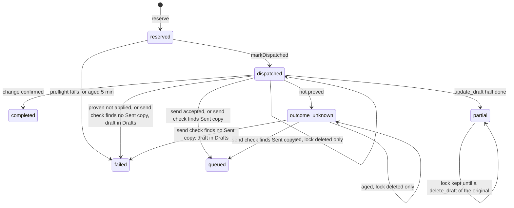

# How a mail write is recorded, locked, settled, recovered and expired

This is the one place that explains the whole life of a write made through `wildduck-mcp`: `create_draft`, `create_reply_draft`, `update_draft`, `delete_draft`, `send_draft`, `move_message` and `update_message_flags`. Read it top to bottom once. After that, use the table of contents to find the part you need.

- [The problem this solves](#the-problem-this-solves)
- [Vocabulary](#vocabulary)
- [State diagram](#state-diagram)
- [When a lock ends](#when-a-lock-ends)
- [Why this is safe](#why-this-is-safe)
- [How a message is treated when its record no longer vouches for it](#how-a-message-is-treated-when-its-record-no-longer-vouches-for-it)
- [What fails as "failed" and what as "unknown"](#what-fails-as-failed-and-what-as-unknown)
- [Time budget of one request](#time-budget-of-one-request)
- [Stored format](#stored-format)
- [Retention](#retention)
- [Capacity](#capacity)
- [Log events](#log-events)
- [Runbook: a message is locked](#runbook-a-message-is-locked)
- [One-time migration after deploying 0.11.0](#one-time-migration-after-deploying-0110)
- [Where to change things](#where-to-change-things)

## The problem this solves

An agent asks this server to change a message. The server then makes one or more requests to WildDuck (the mail server). Any of those can fail in a way that does not say whether the change happened: a timeout, a lost reply, a Lambda that is stopped half way. If the server just retried, it could send an email twice or delete the wrong draft. If it gave up, it could not tell the agent the truth.

So the server writes down what it is about to do before it does it. It stores an **operation record** in DynamoDB, in the one table this service uses, before the first WildDuck request that changes anything. The record holds the request's identity, its state, and at the end its result (the **receipt**). A retry with the same `operationId` finds the record and returns the stored result instead of acting again. For a write that targets an existing message, the server also stores a **lock** on that message (the code calls it a **guard**, and sometimes a **fence**), so that two changes to one message cannot run at the same time. The lock exists only while the change is unfinished or its outcome is uncertain.

The **marker** is a small entry, `wildduckMcpOperationV1`, that the server writes into the message's `metaData` in WildDuck whenever it creates or changes the message. It names the operation record that last changed the message. Later, when an agent wants to edit or send a draft, the server reads the marker, looks up that record and checks that the message is still what that record says it is. Without the marker, a draft this server created could not be told apart from one written by another mail client, and the server only edits or sends drafts it can prove it wrote itself.

## Vocabulary

| Term | Meaning | Code name |
|---|---|---|
| Operation record | One DynamoDB item per write request. Holds the intent (tool, target message, expected version, digest of the arguments), the state, a unique owner token, a revision counter, `reservedAt`, and once settled the receipt. Key: account, OAuth client hash, `operationId`. | `MailOperationRecord` (`src/mail/contracts.ts`), item key `opKey()` in `src/mail/dynamo-store.ts` |
| Guard (lock, fence) | One DynamoDB item per message that has an unfinished or uncertain change. Key: account, mailbox, UID. It names the record that owns it. While it exists, no other write may touch that message. | `DraftGuardRecord`, `guardKey()`; the conflict reason `draft_fenced` |
| Hold | The period from the moment the guard is written until it is deleted. | (no type; `holdAction` and `endHold` in `src/mail/service.ts`) |
| Marker | The `wildduckMcpOperationV1` entry in a WildDuck message's `metaData`: account, client hash, `operationId`, payload digest and tool of the operation that last changed the message. Never shown to agents. | `MailOperationMarker`, `MAIL_OPERATION_METADATA_KEY` |
| Receipt | The stored final result of a write: `completed`, `partial`, `queued`, `failed` or `outcome_unknown`. A retry with the same `operationId` returns it. | `MailReceipt`, field `receipt` of a settled record |
| Reserved | The record and the guard have been written; no WildDuck request that changes anything has been made yet. | state `reserved` |
| Dispatch | The moment the record is moved to `dispatched`, just before the first WildDuck request that changes anything. After it the outcome may be unknown. | `markDispatched`, state `dispatched` |
| Settled | The record holds a receipt. | state `settled` |
| Owner token | A random value made for each call and stored in both the record and the guard. Only the call that made it, or a recovery that read it from the store, can change them. | `ownerToken` |
| Revision | A counter in the record and the guard, increased at every change. | `revision` |
| Aged | The record's `reservedAt` is at least 5 minutes old (15 for an uncertain `send_draft`). A record with no `reservedAt` counts as aged, except an uncertain `send_draft`, which then never ages. | `HOLD_AGED_MS`, `SEND_CHECK_AGED_MS` in `src/mail/service.ts` |
| Recovery | Ending an old hold: settling or releasing it. It runs only when a request touches the message. | `holdAction`, `endHold` in `src/mail/service.ts` |
| Proof, source grade | Proof: the receipt's record of the exact message it produced (account, mailbox, UID, SHA-256 of the whole source). Source grade: `mcp_authored` (this server created the message and the proof matches) or `observed` (any other message). Only `mcp_authored` drafts can be edited or sent. | `ActivationProof`, `SourceGrade` in `src/mail/schemas.ts` |

## State diagram

The diagram shows the states of an operation record. `completed`, `queued`, `failed`, `partial` and `outcome_unknown` are the `status` of the receipt of a settled record. The lock, written together with the record, is deleted on every transition that ends in `completed`, `queued` or `failed`. It stays for `dispatched`, `outcome_unknown` and for the `partial` result of `update_draft` described below. A self-arrow means the record is left as it is: on `dispatched` and `outcome_unknown` the lock is deleted once aged (5 minutes, or for a send 15 minutes and a send check that finds neither a Sent copy nor the draft), on `partial` the lock is kept until a `delete_draft` of the original takes it over. The send check (from `dispatched` or `outcome_unknown`, at 15 minutes) looks in Sent first, then in Drafts. An uncertain send with no `reservedAt` (written before 0.11.0) never ages and is never checked. The next section has the exact rules.


<details>
<summary>Diagram source (Mermaid syntax) and how to change it</summary>

The picture is rendered from this source with `pele` (npm package `pele`, a Mermaid-syntax renderer; its `render(text)` returns `{ svg }`). To change the diagram, edit the source, render it, and replace `docs/mail-write-lifecycle.svg`. That file is the renderer's output with one addition: `background:var(--pele-bg,#fff);` at the start of the `style` attribute of the root element, so the diagram stays readable on a dark page.



</details>

"Preflight" is everything the server does after reserving and before dispatching: reading the message, checking who wrote it, downloading the source, resolving attachments, composing the new draft. A failure there changes nothing in WildDuck, so it settles as `failed`.

## When a lock ends

There are two moments at which a lock ends. The first is the write's own settlement. The second is recovery, which happens later, when a request touches an old hold.

### At settlement (`transition()` in `src/mail/dynamo-store.ts`)

Every change of an attempt's record goes through `transition()`. The record and the lock change in one DynamoDB transaction.

| The attempt stores | The record becomes | The lock |
|---|---|---|
| `markDispatched` | `dispatched` | rewritten as `dispatched` |
| a `completed` receipt | `settled` | deleted in the same transaction |
| a `queued` receipt | `settled` | deleted |
| a `failed` receipt (`failPreflight` before dispatch, `failDispatched` after a proven failure) | `settled` | deleted |
| a `partial` receipt of `update_draft` with reason `original_deletion_failed` or `original_deletion_unconfirmed` (both copies of the draft are alive) | `settled` | kept, rewritten as `retired` |
| any other `partial` receipt (`candidate_verification_failed`, `original_version_changed`, `original_verification_failed`) | `settled` | deleted |
| `outcome_unknown` (`markOutcomeUnknown`) | `settled` | kept, rewritten as `outcome_unknown` |

Every write above also sets the item's `expiresAt` to now plus `RECORD_TTL_SECONDS` (see [Retention](#retention)).

### Recovery (`holdAction` and `endHold` in `src/mail/service.ts`)

`holdAction(owner, now)` decides, from the owning record and the clock, what to do with a hold; it is a pure function, exported, with no I/O. `endHold` does it. The "owner" is the operation record that owns the lock; "age" is now minus the owner's `reservedAt`.

| Owner state | Age | What happens to the record | What happens to the lock |
|---|---|---|---|
| none (the record expired) | any | nothing | deleted (action `release`, logged as `from: "expired"`) |
| `reserved` | under 5 minutes | nothing | kept. A retry with the same `operationId` answers `in_progress`; another write answers `conflict` (`draft_fenced`) |
| `reserved` | 5 minutes or more | settled as `failed` with reason `temporarily_unavailable` (`failPreflight`) | deleted in the same transaction |
| `dispatched`, or `settled` with receipt `outcome_unknown`, tool other than `send_draft` | under 5 minutes | nothing | kept |
| the same, tool other than `send_draft` | 5 minutes or more | left as it is: still `dispatched` or `outcome_unknown` | deleted (`releaseGuard`) |
| the same, tool `send_draft` | under 15 minutes | nothing | kept |
| the same, tool `send_draft` | no `reservedAt` (written before 0.11.0) | nothing, ever: it is never checked | kept until it expires (`expiresAt`) |
| the same, tool `send_draft` | 15 minutes or more, a copy carrying this operation's whole marker is in Sent and not flagged as a draft (looked for first, whether or not the draft is still in Drafts) | settled as `queued`, with `sent` set; `queueId` is set only if WildDuck still reports one | deleted in the same transaction |
| the same, tool `send_draft` | 15 minutes or more, no such copy, and WildDuck still has the draft in Drafts | settled as `failed` with reason `upstream_timeout` (`resolveUnknown`) | deleted in the same transaction |
| the same, tool `send_draft` | 15 minutes or more, no such copy and the draft is gone | left as `outcome_unknown` | deleted |
| the same, tool `send_draft` | 15 minutes or more, a WildDuck lookup fails | nothing | kept (logged as `mail_write_unsettled`, step `send_check`) |
| `settled` `partial` of `update_draft`, both copies alive | any | nothing | kept, except that a `delete_draft` of that same original message takes it over, once the delete's own read-only inspection passes (the message is at that UID, at the request's `expectedVersion`, and its marker checks out): the lock is deleted and the delete proceeds. If the inspection fails, the lock stays and the request gets that failure as an error, with nothing stored; if the message is already gone (`not_found`), the lock is deleted and the delete gets its normal `failed` (`not_found`) |
| any other `settled` receipt (`completed`, `failed`, `queued`, any other `partial`) | any | nothing | deleted. A lock should not exist here; one can be a leftover of an older release |

Every rule needs the guard it deletes to belong to that very owner and to still equal what was read. `endHold` first compares the guard's whole identity with the owner it read: the operation key, the `ownerToken` and the `revision` (the store keeps a guard's revision equal to its owner's in every state, the kept `retired` guard included). The delete itself is conditional on the whole stored guard (`guardDelete()` in `src/mail/dynamo-store.ts`). If either differs, nothing is deleted.

The two thresholds are `HOLD_AGED_MS` (300 000 ms, 5 minutes) and `SEND_CHECK_AGED_MS` (900 000 ms, 15 minutes), both exported from `src/mail/service.ts`. `RECORD_TTL_SECONDS` (90 days) is in `src/mail/dynamo-store.ts`. The admin script's `show` calls `holdAction` itself and has no copy of the ages or of the rules.

**Recovery runs only when a request touches the message.** The two triggers are a retry with the same `operationId` (trigger `retry` in the log) and a different write that reaches the lock (trigger `lock_hit`). There is no background job and no scheduled scan. The reasons: the table is 1 read and 1 write unit provisioned on the AWS free tier; the Lambda role has no permission to scan the table; and traffic is very low, so a lock that nobody touches harms nobody. When the next request comes, it ends the old hold first and then does its own work.

A lock hit ends the old hold and then reserves once more. If that second reservation meets a lock again, the answer is `conflict` (`draft_fenced`); it is not tried a third time.

## Why this is safe

**Compare-and-set.** Every write that an attempt makes to its record is conditioned on the whole stored record being equal to what the attempt read, including the unique `ownerToken` and the `revision` (`checkedPut()`: `#record = :before`). The lock is changed in the same transaction and is also checked: it must belong to the same operation, owner token and revision, and be in the expected state. Recovery uses the same condition, with the owner token and revision it read from the store. Two writers can therefore not both succeed on one record: exactly one wins and the other changes nothing.

**Guard identity.** Before recovery deletes a lock, it checks that the lock names the owner it read, by operation key, `ownerToken` and `revision`, not by the key alone. After an owner record and its lock have both expired, the same `operationId` can be reserved again on the same message, with a new owner token and revision 0. A retry still running from the old incarnation then finds a lock with its own key; the owner token tells it the lock is not its own, so it leaves it alone (`tests/mail-service.test.ts`, "a stale retry never deletes the guard of a later incarnation").

This settles the one dangerous race. Suppose a request reserved a write and then stalled, and a later request judged the reservation aged and abandoned it (settled it `failed`, which deletes the lock). When the first request wakes up, its `markDispatched` is a compare-and-set against a record that has changed, so it fails. The service calls WildDuck only after `markDispatched` has returned, so the resumed request makes no WildDuck call. The reverse order is safe too: if `markDispatched` lands first, the abandon fails and the hold stays. The clock decides only when clean-up is attempted. It does not decide who is right.

**Where time is trusted.** One rule rests on an assumption about time and not only on the compare-and-set: a `dispatched` or `outcome_unknown` hold older than 5 minutes is released on the belief that the request that made it has stopped. The Lambda is killed at 60 seconds, so 5 minutes is five times its limit; a test pins `HOLD_AGED_MS` at no less than twice the longest timeout (`tests/mail-service.test.ts`). If that belief were ever wrong, the late request would find its lock gone and could not store its result, and another change could run on the message while the first WildDuck call was still in flight. Ages are never overstated: the store writes `reservedAt` as the clock rounded up to a whole second, so a hold can look up to one second younger than it is, never older, and no age check fires early. A record with no `reservedAt` was written by a release before 0.11.0; it counts as aged, except an uncertain `send_draft`, which is never checked or released, because a request of the older release may still have been submitting it when 0.11.0 was deployed. Its lock lasts until its items expire.

**The send check, and the one risk accepted.** An uncertain `send_draft` is not settled from a guess. After 15 minutes the server looks at WildDuck (`findSentCopy` and `draftPresent` in `src/mail/backend.ts`), Sent first:

1. Is there a copy in `\Sent` that carries this operation's whole marker (all five marker fields, not just the `operationId`) and is not flagged as a draft? A message moved to Sent by hand keeps its draft flag, so it never matches. The search is bounded: the thread when it is known, otherwise at most 3 pages of 50 messages, newest first. A copy found means the mail was sent, even if the draft is still in Drafts: WildDuck's submit queues the mail, then moves the draft to Sent by storing the Sent copy and then deleting the draft (`submitStoredMessage` in `lib/api/messages.js` and `moveAsync` in `lib/message-handler.js` of the WildDuck fork), so a failed delete leaves both. A miss proves nothing.
2. If none is found, is the draft still in Drafts? It asks for that exact UID. With no Sent copy, a draft still in Drafts means the send did not happen. Only a 404 with WildDuck's code `MessageNotFound` counts as "gone"; any other failure proves nothing and ends the check without a result.

The accepted risk: WildDuck queues the mail before it stores the Sent copy. If storing it fails, the mail is queued and will be delivered, but there is no Sent copy and the draft stays in Drafts. After 15 minutes the server settles the send as "not sent". An agent that then creates the draft again and sends it can send the same mail a second time. The same applies if the bounded Sent search misses a copy that is there while the draft also is. The owner accepted this on 2026-11-17 as rare and harmless. (The same applies if a submit is somehow still running after 15 minutes.) A change in the WildDuck fork would remove it: record the queue ID on the draft when the mail is queued, so that "queued but not stored in Sent" can be seen. That change is not made.

**The hand-over of an update's original, and the residual accepted.** The lock kept on the original after a half-finished `update_draft` is released for a `delete_draft` of that message only after the delete's own read-only inspection passes, inside the preflight window, so a delete with a stale `expectedVersion`, or one that would fail its preflight for any other reason, never unlocks the original. The residual: between that release and the delete's new reservation, the original is unlocked and could be changed or sent; and if the delete itself then ends `outcome_unknown`, its own lock is released once aged (5 minutes), and an original that survived is unlocked from then on. The owner accepts rare duplicates in exchange for no hold that waits for a person.

The old draft itself cannot be sent again: its marker points at a `failed` record, so `send_draft` refuses it (see the next section), and `delete_draft` still works.

## How a message is treated when its record no longer vouches for it

Every write reads the message's marker and the record it names (`provenance()` and `inspect()` in `src/mail/service.ts`). Normally, a marker that does not lead to a verified record makes the write fail with `verification_failed`. In exactly four cases the message is instead treated as **mail this server did not write**:

1. The marker names a record that no longer exists (it expired).
2. The record is `dispatched` or settled `outcome_unknown`, is aged (5 minutes or more, or has no `reservedAt`), and its own tool (the record's `intent.tool`, not the marker's) is not `send_draft`.
3. The record is `failed`, or a `partial` whose copy never became active, and the write is `delete_draft`.
4. The record is a `queued` `send_draft`, the message is that send's own target (the draft, left in Drafts because WildDuck stored the Sent copy and then failed to delete the draft), and the write is `delete_draft`. The rule is the same whether or not the receipt names its Sent copy (`sent`; older receipts may lack it). The Sent copy itself is verified, as before; any other message carrying the send's marker is refused.

What the agent can and cannot do with such a message:

- It can `move_message`, `update_message_flags`, and (for a draft) `delete_draft`. These run as changes to an `observed` message.
- It cannot `update_draft` or `send_draft`. No source is granted for it, so those fail as `unsupported_content`, and the result tells the agent to create the draft again.
- A marker that names a not yet aged uncertain `send_draft`, a record still `reserved`, or a record that disagrees with the marker keeps refusing every write.
- A `failed` record refuses every write except `delete_draft`, and so does a `queued` send on its own leftover draft.

A message treated this way can only ever regain the `observed` grade; it can never become `mcp_authored`, so it can never become sendable. The consequence: **a draft older than 90 days, or one whose send failed, must be created again** before it can be edited or sent. Each write through this server replaces the message's marker with that write's own, so the 90 days count from the last change made here.

## What fails as "failed" and what as "unknown"

After dispatch, a failure is settled as `failed` (and the lock is deleted) only when WildDuck's answer, or the place where the failure happened, proves that the requested change did not take effect. The backend marks such an error `notApplied` (`MailError.notApplied`, `src/mail/contracts.ts`). Anything not proved settles as `outcome_unknown` and keeps the lock.

The proofs, in `src/mail/backend.ts`:

| Tool | Counts as "not applied" |
|---|---|
| `move_message`, `update_message_flags` | any failure before the changing request (input checks, reading the message, reading the destination mailbox); the changing request (a PUT) answered with HTTP 404 and WildDuck code `MessageNotFound` |
| `delete_draft` | the DELETE answered 404 with code `MessageNotFound` |
| `send_draft`, stamp (the PUT that writes the send marker onto the draft) | a failure before the PUT; the PUT answered 404 with `MessageNotFound`; the PUT was acknowledged but the read-back check then failed (the send request has not been made yet at that point) |
| `send_draft`, submit (the request that queues the mail) | the answer carries one of these codes with its own status: `MessageNotDraft` with 400; `TooMany` with 403; `RateLimitedError` with 403; `UserDisabled` with 403; `UserNotFound` with 404 |
| `create_draft`, `create_reply_draft`, `update_draft` | nothing after dispatch. Preflight failures are `failed`; a failure after the upload is `outcome_unknown` or `partial` |

The allowlists are `SUBMIT_UNQUEUED` and `MESSAGE_ABSENT` in `src/mail/backend.ts`. WildDuck returns each listed code before it queues the mail or changes anything; the comments there give the lines in the WildDuck source that were checked.

What does not count, and why:

- **A bare HTTP status.** The same status can come from a request that did change something; for example a 404 can follow queueing. Only the code together with its own status counts.
- **A timeout, an aborted request, a 5xx or a 429.** The request may still be running or may land later. A stamp PUT that timed out can still land later and overwrite the marker of a later operation.
- **A submit that succeeded but has no usable queue ID.** The mail may well be queued.
- **`MessageNotFound` on the submit.** It is left out on purpose.

If the dispatch mark itself fails, no WildDuck request has been made, so the call answers `failed` (its own record is settled `temporarily_unavailable`) or `in_progress`, never `outcome_unknown`; a record that another call has already settled is replayed.

## Time budget of one request

The Lambda has 60 seconds (`provider.timeout` in `serverless.yml`). A write divides them as follows. The full commentary is the comment above `PREFLIGHT_RESERVE_MS` in `src/mail/service.ts`.

| Constant | Value | Defined in | What it protects |
|---|---|---|---|
| `PREFLIGHT_RESERVE_MS` | 20 000 ms | `src/mail/service.ts` | The preflight window ends this long before the request does (at 40 s of 60 s). The 20 s after it are for recording a failure (one store operation, at most 10 s throttled plus 2 s response), or for dispatching, uploading, verifying and recording the result (about 15 s with DynamoDB healthy). |
| `RESERVE_ADMISSION_MS` | 10 000 ms (equal to `DEFAULT_THROTTLE_TIMEOUT_MS`) | `src/mail/service.ts` | A write reserves only if at least this much of the window is left, so even the slowest reservation ends by the window's end. A write that starts with under 30 s of the request left fails `temporarily_unavailable` with nothing stored; the same `operationId` then works on retry. |
| `DEFAULT_THROTTLE_TIMEOUT_MS` | 10 000 ms | `src/dynamo-retry.ts` | The most one store operation may take once DynamoDB has throttled it. The mail store refuses to start with a larger value, because the numbers above derive from it. |
| `RESPONSE_RESERVE_MS` | 2 000 ms | `src/dynamo-retry.ts` | Kept back for the response itself. |
| unthrottled `timeoutMs` | 5 000 ms at most | `src/mail/dynamo-store.ts` | A DynamoDB call that was never throttled is aborted after this. |
| `SETTLEMENT_RESERVE_MS` | 12 000 ms (throttle budget plus response reserve) | `src/mail/service.ts` | When a reservation's outcome is unknown, it is read back once, ending this long before the request does, so that settling it as `failed` still has a full throttled write. The completion write is retried once, only with at least this much left. |
| `RESOLVE_RESERVE_MS`, `RESOLVE_MAX_MS` | 5 000 ms, 30 000 ms | `src/mail/backend.ts` | Attachment resolution ends 5 s before the window and takes at most 30 s. |
| `HOLD_AGED_MS`, `SEND_CHECK_AGED_MS` | 300 000 ms, 900 000 ms | `src/mail/service.ts` | These are not part of one request; they are the ages, counted across requests, at which a hold may be ended. |

Where recovery fits: on a same-`operationId` retry, `endHold` runs inside the preflight window and the call never dispatches. On a lock hit, `endHold` runs inside the window and is cut off `RESERVE_ADMISSION_MS` before the window ends, so a whole reservation always still fits; after it, the admission check is made again before the second reservation, and the preflight that follows is shorter, never later. The send check makes up to six WildDuck GETs (one mailbox listing, up to three Sent pages, one for the queue ID, one for the draft). The hand-over of an update's original runs the delete's inspection there as well (reading the message and its marker's record), before the lock is released.

## Stored format

All records are items in the one DynamoDB table, in the key namespace `wildduck-mcp#`. Each item has `pk`, `sk` (always `STATE`), the attribute `record`, and optionally `expiresAt`. A reader accepts nothing else: the item and the record are strict schemas.

**Operation record item** (`opKey()`, `operationSchema` in `src/mail/dynamo-store.ts`)

| Attribute | Content | First written by |
|---|---|---|
| `pk` | `wildduck-mcp#mail-operation#<accountId>#<clientIdHash>#<operationId>` | 0.6.x to 0.9.x wrote the same layout; still written |
| `sk` | `STATE` | the same |
| `record.key`, `record.intent` | the operation key; the intent (`tool`, `payloadDigest`, and for a targeted tool `target` and `expectedVersion`) | the same |
| `record.ownerToken`, `record.revision`, `record.state` | owner token; counter; `reserved`, `dispatched` or `settled` | the same |
| `record.receipt` | present once settled; the stored receipt | the same |
| `record.reservedAt` | epoch seconds, the clock rounded up, set at reserve, never changed afterwards | 0.11.0 |
| `expiresAt` | epoch seconds, top level, the table's TTL attribute: now plus `RECORD_TTL_SECONDS` at reserve, set again at every write of the item | 0.11.0 |

**Guard item** (`guardKey()`, `guardSchema`)

| Attribute | Content | First written by |
|---|---|---|
| `pk` | `wildduck-mcp#mail-guard#<accountId>#<mailboxId>#<uid>` | 0.6.x to 0.9.x wrote the same layout; still written |
| `record.key`, `record.operation`, `record.ownerToken`, `record.revision` | the message; the owning operation's key; owner token; counter | the same |
| `record.state` | `reserved`, `dispatched`, `outcome_unknown`, `retired` (only for an `update_draft` with both copies alive). `queued` is read but no longer written. | `queued` was written by releases before 0.11.0; the others still are |
| `expiresAt` | as above | 0.11.0 |

**What readers tolerate.** Since 0.10.0 a reader accepts an optional `record.reservedAt` (a positive integer) and an optional numeric top-level `expiresAt`, and ignores both when reading. Reads never filter on `expiresAt`: an item that is past its time but not yet deleted is read normally. A stored `queued` receipt may have no `queueId`. A guard may be in state `retired` or `queued`. A `summary` found inside a receipt is dropped on read; summaries are worked out again whenever a result is returned and are never stored. A record from before 0.11.0 has no `reservedAt` and no `expiresAt`; a missing `reservedAt` counts as aged, except on an uncertain `send_draft`, which is then never checked.

**The two old spellings.** A stored receipt keeps the field name `operation_id` (`STORED_OPERATION_ID` in `src/mail/dynamo-store.ts`); tool results call it `operationId` (renamed in 0.7.0). The reader accepts both and the writer always writes the old one, so a receipt written by 0.6.x replays unchanged. The same applies to the payload digest: it is computed over the arguments with `expectedVersion` named `expected_version` (`digestedPayload()` in `src/mail/service.ts`), so an identical retry of a request recorded by 0.6.x still matches its stored digest. The condition used to settle a record that already holds an `outcome_unknown` receipt must use the stored spelling; `resolveUnknown` does.

**Rollback floor.** 0.10.0 is the oldest release that can read what 0.11.0 writes. Releases before 0.10.0 reject items that carry `reservedAt` or `expiresAt`. After 0.11.0 is deployed, do not roll back past 0.10.0.

## Retention

- Operation records and guards get `expiresAt` = now + `RECORD_TTL_SECONDS` (90 days, `src/mail/dynamo-store.ts`) when written, and again at every later write. A record usually settles within seconds, so it expires about 90 days after it settled. A guard is normally deleted at the end of its hold, so it exists only for an uncertain outcome or a half-finished `update_draft`.
- A guard held for an `update_draft` with both copies alive stays until a `delete_draft` of the original takes it over, or until it expires 90 days after its last write.
- Other items in the table: attachment-upload records expire after `UPLOAD_TTL_SECONDS` (15 minutes); OAuth records have their own expiry.
- **TTL deletion is lazy.** DynamoDB removes an expired item in the background some time after `expiresAt` (AWS documents typically within 48 hours, with no guarantee). The code never relies on it: a record past its time but still present is read as valid. This is harmless; at worst a message is treated as written by this server for a little longer.
- **A guard and its record expire at different times.** They are always written in the same transaction, so they get the same `expiresAt`, but DynamoDB deletes them independently. If the record is deleted first, the guard has no owner: the next request that touches the message deletes the guard (`release`, `from: "expired"`), and the message is treated as mail this server did not write. If the guard is deleted first, the hold is simply over.

## Capacity

The table is provisioned at exactly 1 read capacity unit (RCU) and 1 write capacity unit (WCU), with no index and no autoscaling (`serverless.yml`, pinned by `tests/infrastructure.test.ts`). A strongly consistent read of an item up to 4 KB costs 1 RCU. A transactional write costs 2 WCU for each item of up to 1 KB, and more for larger items. The sizes below are estimates: item sizes were not measured, and settled records with proofs may exceed 1 KB, which would double their cost.

| Request | DynamoDB calls | Write units (estimate) |
|---|---|---|
| Retry of a settled write with the same `operationId` | 1 read | none |
| `create_draft`, `create_reply_draft` | 3 reads and 3 transactions of one item each (reserve, mark dispatched, complete) | about 6 WCU |
| Write on an existing message (`update_draft`, `delete_draft`, `send_draft`, `move_message`, `update_message_flags`) | 5 reads and 3 transactions of two items each: the first check, then one operation read and one guard read for each of the two later changes | about 12 WCU |
| Recovery of an old hold | a few reads and one transaction (one or two items), before the write's own work | about 2 to 4 WCU |

At 1 WCU per second, a burst is paid for by DynamoDB's saved-up burst capacity, and then by throttling. Throttling is expected and is handled in `src/dynamo-retry.ts` (shared by the auth, mail and upload stores): a throttled call waits a random time up to 200 ms, doubling to at most 1.6 s per wait, and tries again. A call that was never throttled gives up after 5 s; once throttled it may take up to 10 s in total (`DEFAULT_THROTTLE_TIMEOUT_MS`). Both limits are shortened to the live request time minus 2 s. Other transient errors get two short retries (25 ms, then 50 ms). A failed condition is never retried. A retried transaction reuses its `ClientRequestToken`, so it cannot apply twice.

Each throttle logs one `dynamodb_throttled` line. Count them to decide whether the capacity is enough (see [Log events](#log-events)): occasional lines during bursts are normal; a steady stream, or write calls ending in `temporarily_unavailable`, means the table needs more capacity.

## Log events

Every line is one JSON object written with `console.warn`, so it lands in the Lambda's CloudWatch log group. Every field is a fixed literal, an enum, an allowlisted code or a server-generated ID. **No account data is ever logged**: no account, mailbox, message, operation or OAuth client identifiers, no subjects, addresses or bodies, no keys, table names, tokens or error text.

| Event | Fields | What it tells an operator |
|---|---|---|
| `dynamodb_throttled` | `store` (`mail`, `auth` or `upload`), `operation` (`get`, `batch_get`, `put` or `transact`), `attempt` (the number of this send attempt within the call) | DynamoDB throttled a call and it was retried. The evidence for a capacity decision. |
| `dynamodb_failed` | `store`, `operation`, `kind` (`stalled`, `deadline`, `transient_exhausted`, `access_denied`, `validation`, `other`) | A call ended in a failure that is neither throttling nor a failed condition. `stalled`: no answer within the time limit; `deadline`: the request had no time left; `transient_exhausted`: short retries used up; `access_denied`: a missing permission or bad credentials; `validation`: DynamoDB rejected the request itself. |
| `mail_write_unsettled` | `tool`, `step`, `code`, `requestId` when there is one | A write ended with no settled record, or an unknown outcome. `step`: `reserve` (the reservation's outcome could not be proved or settled), `preflight_settle` (preflight failed and the failure could not be stored), `dispatch_mark` (the dispatch mark failed and the call could not settle; it answered `in_progress`), `upstream` (a WildDuck call failed after dispatch, outcome unknown), `complete` (the change took effect but the final write failed), `unknown_mark` (even the unknown outcome could not be stored; the record stays `dispatched` and its lock stays), `send_check` (the send check's WildDuck lookup failed). `code`: a WildDuck code from the allowlist (`InvalidToken`, `MessageNotDraft`, `TooMany`, `RateLimitedError`, `UserDisabled`, `UserNotFound`, `MessageNotFound`; `KNOWN_UPSTREAM_CODES` in `src/mail/contracts.ts`) or a failure reason of the result such as `upstream_timeout`. |
| `mail_write_recovered` | `tool` (absent if the record had expired), `trigger` (`retry` or `lock_hit`), `from` (`reserved`, `dispatched`, `unknown`, `expired`, `leftover`, `partial`), `action` (`failed`, `released`, `sent_found`, `not_sent`), `requestId` | An old hold was ended. `failed`: an aged reservation settled as failed. `released`: only the lock was deleted. `sent_found`: the send check found the copy in Sent and settled `queued`. `not_sent`: the draft was still in Drafts and the send settled `failed`. |
| `mail_tool_error` | `tool`, `requestId`, `code` (a failure reason), and for `search_messages` only `cause` and `status` (the upstream HTTP status) | A tool call threw an error. `requestId` is the same ID shown to the agent in the error text ("Request ID: ..."), so an agent's report can be matched to the log. Write receipts such as `in_progress` or `outcome_unknown` are results, not errors: they carry no such ID and produce no `mail_tool_error`. |

`dynamodb_*` lines carry no `requestId`; match them to a request by time.

## Runbook: a message is locked

Use this when an agent keeps getting `conflict` for a message, an `in_progress` that does not end, or an `outcome_unknown` it cannot get past. In most cases the right action is to wait.

### 1. What the agent sees and what it should do

| What the agent sees | Meaning | What the agent should do |
|---|---|---|
| `conflict` with reason `draft_fenced` | Another change to this message is not finished. Nothing was changed. | Retry the identical request in a few minutes. The next request ends a hold once it is 5 minutes old (15 for an uncertain send). The old copy left by a half-finished `update_draft` can only be deleted. |
| `conflict` with reason `operation_conflict` | This `operationId` was used before with other arguments. Nothing changed. | Use a new `operationId` for a new action. |
| `in_progress` | This `operationId` has no final result and none is recorded. | Retry the identical request after a few seconds, then again later. After about 5 minutes it reports a final result (`failed`). Never repeat the change under a new `operationId`. |
| `outcome_unknown`, tool `send_draft` | The send was started and its result is not known. | Do not send again. Retry the identical request; after 15 minutes it looks at WildDuck and answers `queued` (sent) or `failed` (not sent, the draft must be created again), or stays unknown if it finds nothing, in which case the agent looks in Sent and tells the user. |
| `outcome_unknown`, any other tool | The change was started and its result is not known. | Retrying the identical request only looks up the recorded result. Read the current state and tell the user. After about 5 minutes the message can be changed again with a new `operationId`; if editing or sending a draft is then refused, create the draft again. |
| `partial` | `update_draft` saved a new copy but could not finish; the result says which copy to use. | Follow the result's `summary`. Where both copies are alive, the original can only be deleted. |
| `failed` | The change was not applied and the message is no longer locked. | Fix the cause, then try again with a new `operationId`. A failed `send_draft` may have stamped the draft; if a new send is refused, create the draft again. |
| An error `verification_failed` on a write | The marker's record is unfinished, uncertain, failed or does not match, or the message was changed elsewhere. | Read the message and check `managedOperation.verification`. |

### 2. When to simply wait

A hold ends by itself, on the next request that touches the message, once it is old enough: **5 minutes** for a reserved or dispatched write, **15 minutes** for an uncertain send. If an agent retries after that, the lock is gone. Every lock ends by itself, and every row expires 90 days after it was last written, so nothing waits for an operator. Use `show` below when an agent reports something that does not match this table.

### 3. Inspect the lock

With your own AWS credentials (the Lambda role can only read and write single items; this script is the only thing that scans):

```sh
bun scripts/mail-ledger.ts show <accountId> <mailboxId> <uid>
```

Optional `--table <name>` (default `wildduck-mcp-prod-state`) and `--region <name>` (default `us-west-2`). It reads two items and writes nothing. It never prints `ownerToken` or `payloadDigest`. The `meaning` line is worded from `holdAction` in `src/mail/service.ts`, the function the server itself uses, so it says what the server will do; `describeHold` in `scripts/mail-ledger-core.ts` has one sentence per action and a test fails if the server gains an action it does not describe. `<accountId>` is the WildDuck account id (24 hexadecimal characters); `<mailboxId>` and `<uid>` are those of the message the agent tried to change, as in its list or read results.

Output, for a lock that exists:

```
lock: mailbox <id> uid <n>, state <state>, revision <n>, expiresAt <ISO time or "none (written before 0.11.0)">
operation: <operationId>
  tool <tool>, state <state>, receipt <status (reason) or none>
  reservedAt <ISO time or "none (written before 0.11.0; counts as aged)">, expiresAt <...>
meaning: <one sentence>
```

If there is no lock it prints `No lock on this message: nothing holds it.` and the agent can simply retry. What each `meaning` says, and what to do:

| `meaning` (summary) | What to do |
|---|---|
| The operation record is gone (expired or never written); the lock is abandoned. | Nothing. The next write to the message deletes it. |
| `update_draft` finished halfway; both copies are alive, so the lock is a real hold on the original. | Have the agent `delete_draft` the original (uid shown by the agent's partial result). Otherwise it expires after 90 days. |
| A leftover of an older release (state `retired` or `queued`): the hold already ended. | Nothing. The next write to the message deletes it; `cleanup` deletes it too while the row has no `expiresAt`. |
| Reserved, young: a write is in progress or just died. | Wait until it is 5 minutes old (the output gives the time). This holds for a reservation of any tool, `send_draft` included. |
| Reserved, aged: the request that took it died. | Nothing. The next request settles it `failed` and deletes the lock. |
| Uncertain `send_draft`, young: held until 15 minutes old. | Wait; the agent retries the same request later. |
| Uncertain `send_draft`, aged: the next request looks in WildDuck. | Nothing, or have the agent retry the same request now. |
| Uncertain `send_draft` with no `reservedAt` (written before 0.11.0): its age is unknown, so the server never checks it. | Look in WildDuck (Sent and Drafts) and tell the user. The row expires 90 days after it was last written. |
| Unknown outcome of another tool, young: may still be running. | Wait until it is 5 minutes old. |
| Unknown outcome of another tool, aged: the record stays `outcome_unknown`; the next write deletes the lock. | Nothing. The agent re-reads the message and retries under a new `operationId`. |
| The owning record cannot be read (unreadable format). | Inspect the two items by hand. |

### 4. Removing a row by hand

There is no command that deletes a single lock, and none is needed: every lock ends by itself the next request that touches the message (after 5 minutes; after 15 for an uncertain send), and every row expires 90 days after it was last written. `show` is for looking.

If a row must ever be removed, that is a deliberate `aws dynamodb delete-item` by the owner on the row's `pk` and `sk` (`STATE`), with these consequences:

- A retry of the operation whose lock was removed may then stay `in_progress` until its record expires: settling a record needs its lock, so an aged `reserved` record whose lock is gone is never settled.
- Another change can reach the message while the first one may still be running; for an uncertain `send_draft`, a second send of the same draft can go through.
- For an `update_draft` with both copies alive, someone can change or send the original while the new copy also exists, which makes two drafts. Have the agent `delete_draft` the original instead.

### 5. Find the log lines

The Lambda is `wildduck-mcp-prod-api`; its log group is `/aws/lambda/wildduck-mcp-prod-api`, region `us-west-2`, kept 14 days. Search for the event name as a quoted term (Lambda prefixes each line with a timestamp and request ID, so the line is not pure JSON and a JSON filter pattern would not match). For example, the last day of `mail_write_unsettled` lines:

```sh
aws logs filter-log-events --region us-west-2 \
  --log-group-name /aws/lambda/wildduck-mcp-prod-api \
  --start-time $(( ($(date +%s) - 86400) * 1000 )) \
  --filter-pattern '"mail_write_unsettled"'
```

Replace the quoted term with `"mail_write_recovered"`, `"dynamodb_failed"`, `"dynamodb_throttled"` or `"mail_tool_error"`. Read `step` and `code` in the line against the [Log events](#log-events) table. To follow one request, search for its `requestId` (an agent's error text shows it as "Request ID"). A write receipt such as `in_progress` has no request ID, so use the time of the agent's attempt. Logs older than 14 days are gone.

## One-time migration after deploying 0.11.0

Releases before 0.11.0 left lock rows that nothing deletes and operation records that never expire. This script, run once, deletes the locks whose hold has already ended and gives every old record an `expiresAt`. It uses your own AWS credentials and is the only code that scans the table.

**It acts only on legacy rows**, those with no top-level `expiresAt` (every write from 0.11.0 on sets it). A lock that has `expiresAt` was written by the running server and is left to it, however it looks (a `retired` lock of an `update_draft` with both copies alive is a real hold); an operation item that has `expiresAt` needs nothing. Before **every** lock delete the script reads the lock's owner again with a consistent read and decides again from that fresh copy; it deletes only when the lock and the fresh owner carry the same `ownerToken` and `revision` (the store writes the two with the same revision in one transaction) and the fresh copy gives the same decision. Otherwise the lock is skipped and counted as changed since the scan. The delete itself is conditional on the lock still equalling what was scanned.

1. **Dry run** (the default; writes nothing):

   ```sh
   bun scripts/mail-ledger.ts cleanup
   ```

   It prints a summary. In the order printed:

   - `Scanned N mail items in P pages: X operations, Y guards, Z ignored, U unreadable`. Operation records, lock rows, items that are neither (normally 0) and items that could not be read. Unreadable items are never written, and the exit status is then 1.
   - `Guards by decision`, one count per decision (from `decideGuard` in `scripts/mail-ledger-core.ts`):

     | Decision | Meaning | Action |
     |---|---|---|
     | `delete: owning operation record is missing` | the record expired or never existed | delete the lock, if the fresh read still finds no owner |
     | `delete: hold already ended (retired or queued)` | a leftover of an older release | delete the lock, if the fresh owner matches and still gives this decision |
     | `delete: old unknown outcome, not a send` | a `dispatched` or `outcome_unknown` lock of a tool other than `send_draft`, whose record has no `reservedAt` and so counts as aged | delete the lock, on the same condition; the record stays |
     | `keep: update_draft with both copies alive (real hold)` | a real hold | keep; set `expiresAt` |
     | `leave: send_draft with unknown outcome and no reservedAt (the server never checks it; it expires after 90 days)` | the server cannot tell the age of this send, so it never checks it | leave in place; set `expiresAt`, so it expires after 90 days. Look in WildDuck for the draft and the Sent copy |
     | `leave: reserved, or has reservedAt (server times it out)` | in flight, or recoverable by the server | leave; set `expiresAt` |
     | `leave: owning operation record could not be read` | the record is not in a readable format | leave; set `expiresAt` on the lock |
     | `leave: lock and record disagree (changed during the scan)` | the lock's `ownerToken` or `revision` differs from its owner's: the scan pages straddled a change | leave; set `expiresAt` |
     | `leave: has expiresAt, written by the current version (the server handles it)` | not a legacy row | leave; no write at all |

   - `Operations: A need expiresAt, B already have it` (`B` are the current-version items).
   - `Writes planned: T (D guard deletes, E expiresAt updates)` and `Planned writes by tool`.

   Check that the numbers make sense: the deletes should be roughly the number of old locks, `A` roughly the number of old operation records, and `unreadable` 0. `--verbose` also lists the key of every item acted on.

2. **Apply:**

   ```sh
   bun scripts/mail-ledger.ts cleanup --apply
   ```

   It makes one write at a time, with a pause of 1 second after each write and after each owner re-read, i.e. about one call per second to suit the 1 WCU / 1 RCU table. The scan itself reads 25 items per page with a 1-second pause between pages. A table of a few hundred items takes a few minutes. Throttled calls are retried with doubling waits (1 s, 2 s, 4 s, up to 6 tries); a call that still fails stops the run with "Stopped: a write failed after retries". Re-running is safe. Every write is conditional: a lock is deleted only if it still equals what was scanned, and `expiresAt` is set only on an item that still exists and has none, so an item that changed since the scan is skipped (the output counts them as "skipped"). It prints `Applied N writes (D deletes, E expiresAt updates); skipped S that changed since the scan.`

3. **Confirm:** run the dry run again. It should plan zero writes and print `Nothing to do.`: every item the run left now has `expiresAt`, and only legacy rows are ever planned. Any guard it still lists as `leave` or `keep` is expected; none should be a `delete`.

The default run never writes: it only scans (and `show` only reads two items).

Exit status: 0 success; 1 a failure or unreadable items; 2 a usage error.

## Where to change things

| I want to change... | Where | Tests that pin it |
|---|---|---|
| How old a hold must be before it ends (5 and 15 minutes) | `HOLD_AGED_MS`, `SEND_CHECK_AGED_MS` in `src/mail/service.ts` (the admin script reads them through `holdAction`) | `tests/mail-service.test.ts` (the age is at least twice the Lambda timeout; each row of the rule table), `tests/mail-ledger.test.ts` |
| The rule table for when a hold ends | `holdAction`, `endHold` in `src/mail/service.ts`; for settlement `transition()` in `src/mail/dynamo-store.ts`; the wording of each action in `show` is `describeHold` in `scripts/mail-ledger-core.ts` (an exhaustive switch: a new action must be described there) | `tests/mail-service.test.ts`, `tests/mail-dynamo.test.ts`, `tests/mail-ledger.test.ts` |
| How long records and guards live (90 days) | `RECORD_TTL_SECONDS` in `src/mail/dynamo-store.ts` | `tests/mail-dynamo.test.ts` |
| Which WildDuck answers prove "not applied" | `SUBMIT_UNQUEUED`, `MESSAGE_ABSENT` in `src/mail/backend.ts`; the allowlist of codes that may be logged, `KNOWN_UPSTREAM_CODES` in `src/mail/contracts.ts` | `tests/mail-backend.test.ts`, `tests/mail-service.test.ts` |
| Which messages count as "not written by this server" | `provenance()`, `inspect()` in `src/mail/service.ts` | `tests/mail-service.test.ts` |
| The send check (how the Sent copy is found) | `draftPresent`, `findSentCopy`, `SENT_LOOKUP_PAGE_SIZE`, `SENT_LOOKUP_MAX_PAGES` in `src/mail/backend.ts` | `tests/mail-backend.test.ts`, `tests/mail-service.test.ts` |
| The time budget | `PREFLIGHT_RESERVE_MS`, `RESERVE_ADMISSION_MS`, `SETTLEMENT_RESERVE_MS` in `src/mail/service.ts`; `DEFAULT_THROTTLE_TIMEOUT_MS`, `RESPONSE_RESERVE_MS` in `src/dynamo-retry.ts` | `tests/mail-dynamo.test.ts`, `tests/request-budget.test.ts` |
| Throttle retry and the `dynamodb_*` log lines | `src/dynamo-retry.ts` | `tests/dynamo-retry.test.ts` |
| The `mail_write_*` log lines | `logUnsettled`, `logRecovered` in `src/mail/service.ts` | `tests/mail-service.test.ts` |
| The `mail_tool_error` log line | `src/mcp.ts` | `tests/mail-mcp.test.ts` |
| What agents are told (statuses, advice) | `receiptSummary`, `errorText` in `src/mail/summary.ts`; the `describe` texts of the status schemas in `src/mail/schemas.ts`; `SERVER_INSTRUCTIONS` and the tool descriptions in `src/mcp.ts` | `tests/mail-mcp.test.ts` (including the list of words agents must not be shown) |
| The stored format | `operationSchema`, `guardSchema`, `itemSchema`, `STORED_OPERATION_ID` in `src/mail/dynamo-store.ts` | `tests/mail-dynamo.test.ts` |
| The admin script (`show`, `cleanup`) | `scripts/mail-ledger.ts` (the AWS calls), `scripts/mail-ledger-core.ts` (decisions and output) | `tests/mail-ledger.test.ts` |
| The CI jobs | `.github/workflows/ci.yml` | none |
| How many Lambda versions are kept (5) | `keep_versions` in `scripts/deploy.sh` | `tests/deploy-prune.test.ts` |
| Table capacity and the TTL attribute | `CredentialTable` in `serverless.yml` | `tests/infrastructure.test.ts` |

The DynamoDB Local test of the store (`DYNAMO_LOCAL_MAIL_TEST=1 bun test tests/mail-dynamo.test.ts`, which talks to `http://127.0.0.1:18765`) is not part of `bun run validate`. In CI the `dynamodb-local` job in `.github/workflows/ci.yml` runs it on every push and pull request against a pinned `amazon/dynamodb-local` service container, and the `deploy` job needs that job, so a store regression cannot deploy. To run it locally, start DynamoDB Local on host port 18765 first.
